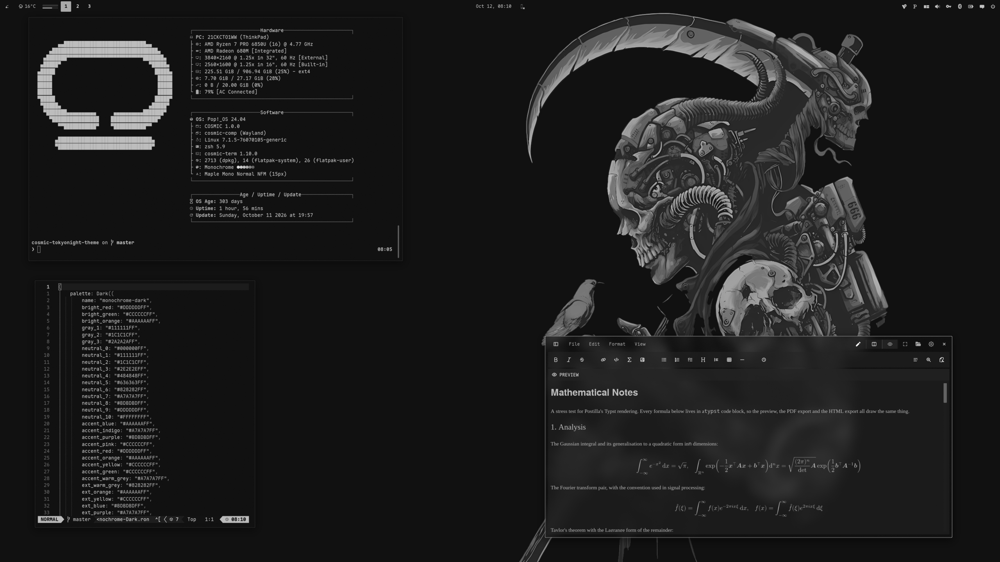
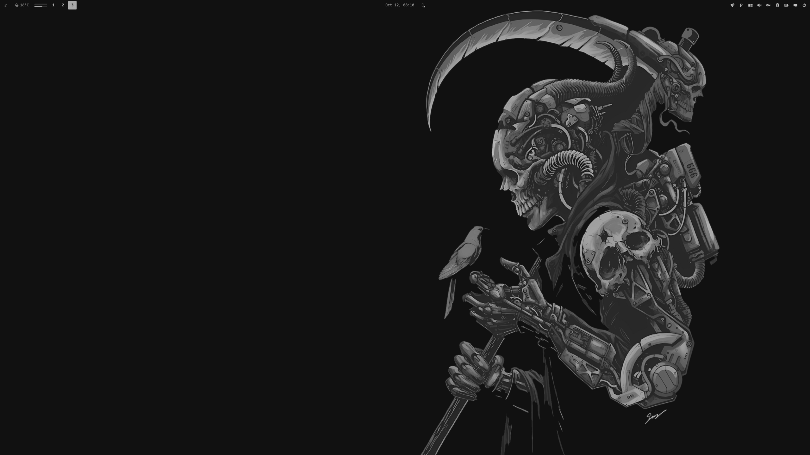

<div align="center">

# COSMIC · Monochrome

Pop!_OS 24.04 on COSMIC in grays only: desktop, terminal, shell, Firefox, Brave, cursor.


</div>

---


## Palette

Sourced from the monochrome dark slots in
[claude-desktop-extra](https://github.com/patrickjaja/claude-desktop-extra/blob/master/themes/palettes/monochrome.svg).

| Role | Color | Hex |
|------|-------|-----|
| Background |  Void | `#111111` |
| Elevated |  Surface | `#1c1c1c` |
| Text |  Mute | `#828282` |
| Primary |  Accent | `#aaaaaa` |
| Secondary |  Control | `#a7a7a7` |
| Border |  Edge | `#bdbdbd` |
| Success |  High | `#cccccc` |
| Error |  Higher | `#dddddd` |

There is no hue. Status colours are lighter grays, not green / red.

---

## Repo Structure

```
.
├── assets
│   ├── cursors/                 # cursor previews
│   ├── screenshot.png           # README screenshot
│   └── wallpaper.png            # the reaper on the bare desktop
├── backgrounds/                 # wallpapers, monochrome-<subject>.png (see Icons and wallpaper)
├── brave
│   ├── theme                    # Chromium theme (manifest + icons), Load unpacked
│   └── README.md
├── btop
│   └── Monochrome.theme         # btop colour theme
├── claude-desktop
│   ├── cosmic-monochrome.jsonc  # Claude Desktop theme (claude-desktop-extra), dark + light
│   └── install.sh
├── cosmic
│   ├── Monochrome-Dark.ron      # COSMIC Appearance import
│   ├── config/                  # baseline settings: fonts, icons, terminal look
│   └── install.sh
├── cosmic-term
│   └── Monochrome-Dark-term.ron # COSMIC Terminal colour scheme
├── cursors
│   ├── Oxygen-Monochrome-*/      # cursor themes, one per icon colour, patched for COSMIC apps
│   ├── install.sh
│   ├── uninstall.sh
│   └── README.md
├── icons
│   └── install.sh               # Cosmic-Monochrome icon pack from cosmic-icon-themes
├── fastfetch
│   ├── config.jsonc             # gray fastfetch config
│   ├── cosmic.txt               # COSMIC logo
│   └── install.sh
├── firefox
│   ├── theme                    # Cosmic Monochrome theme add-on (manifest + icons)
│   ├── chrome
│   │   ├── userChrome.css       # rounded chrome, grey menu hover
│   │   └── userContent.css      # new tab accents, blank tiles
│   ├── install.sh
│   └── README.md
├── lsd
│   ├── config.yaml              # theme: custom
│   ├── colors.yaml              # permission / size / date / git columns
│   └── install.sh
├── nvim                         # Neovim colorscheme, LazyVim spec, RON syntax, install.sh
├── telegram
│   ├── colors.tdesktop-theme    # Telegram Desktop colour scheme (source)
│   ├── cosmic-monochrome.tdesktop-theme  # built theme, open this in Telegram
│   └── build.sh                 # rebuilds it, optionally with a wallpaper
├── vscode
│   ├── themes/                  # Cursor / VS Code colour theme
│   ├── package.json             # extension manifest
│   ├── install.sh               # packs a .vsix, installs it with cursor --install-extension
│   └── README.md
├── scripts
│   ├── update_system.sh         # nala + flatpak, monochrome ANSI
│   └── switch.sh                # make this the active rice (see Switching rice)
├── zsh
│   ├── monochrome.zsh           # LS_COLORS, highlighting colours, aliases, starship
│   └── install.sh
├── docs
│   └── showcase.md              # the rice describing itself, for the Postilla pane of the screenshot
├── LICENSE
└── README.md
```

---

## COSMIC Desktop

Settings → Desktop → Appearance → **Dark** → **Import** → `cosmic/Monochrome-Dark.ron`

Accent tiles will all be gray. That is the theme. Use the `+` control if you want a custom swatch.

Frosted glass is on in the `.ron` at `frosted: Low` with an opacity table of
0.66 to 0.96, tinted with the palette's middle neutral, for windows, panel,
applets and system UI (maximized apps stay solid), and corners are squared
(`radius_*: 2.0`), the same as the DarkGold baseline. Adjust frosted glass on
Appearance → Style → Frosted glass after import; those sliders survive a theme switch.

Export from Appearance if you tweak backgrounds / tints so you do not lose them.

### Baseline settings

`cosmic/config/` holds the settings that make up the look and rarely change
(panel, dock, applets and shortcuts are left out on purpose):

| Where | Setting |
|-------|---------|
| Fonts | Interface `Maple Mono Normal`, monospace `Maple Mono Normal NFM` |
| Icons | Cosmic-Monochrome-Silver |
| Windows | Minimize / maximize buttons hidden, theme applied to GNOME apps |
| Terminal | Maple Mono 15 (weights 500 / bold 800 / dim 300), 77% opacity, no header bar, Monochrome Dark |

Install the [Maple fonts](https://github.com/subframe7536/maple-font/releases)
(Maple Mono Normal and Maple Mono Normal NFM) and the Cosmic-Monochrome icons
(see Icons below) and import the terminal scheme first, then:

```bash
./cosmic/install.sh
```

It backs up each file it replaces to `*.bak` and COSMIC applies it live.

---

## COSMIC Terminal

The desktop `.ron` does not colour ANSI text.

1. COSMIC Terminal → **View → Color schemes…** (not Settings → Appearance)
2. Dark tab → **Import** → `cosmic-term/Monochrome-Dark-term.ron`
3. View → Settings → Appearance → Color scheme (dark) → **Monochrome Dark**

If a profile is set as default, set the scheme on that profile too or the dropdown will look like it did nothing.

---

## Firefox

Two layers:

1. **Theme (colours):** install
   **[cosmic-monochrome-theme on addons.mozilla.org](https://addons.mozilla.org/en-US/firefox/addon/cosmic-monochrome-theme/)**.
   This is the main look.
2. **Stylesheets (optional):** `firefox/chrome/` adds rounded corners, grey
   menu hover, grey accents and blank new-tab tiles on top of the add-on
   (they also work with Firefox's built-in Dark theme):

```bash
./firefox/install.sh
```

Fully quit Firefox afterward. Details and CSS rules: [`firefox/README.md`](firefox/README.md).

---

## Brave

`brave/theme` is a Chromium theme with the Firefox theme's colours: black
frame, charcoal toolbar, grey icons and inactive tabs, bright grey on the active tab.
Brave, Chrome, Chromium and Edge take it, and it loads straight from the
clone, so no Chrome Web Store or Google account is needed:

`brave://extensions` → **Developer mode** → **Load unpacked** → `brave/theme`

Leave the clone in place, Brave keeps reading the folder. Colours, limits and
packing a `.crx`: [`brave/README.md`](brave/README.md).

---

## Claude Desktop

For the unofficial [claude-desktop-extra](https://github.com/patrickjaja/claude-desktop-extra)
Linux build. `claude-desktop/cosmic-monochrome.jsonc` is one theme with both halves:
Monochrome in dark mode and the same greys mirrored in light mode,
so Claude's own Settings → Appearance toggle keeps working.
Colours come from `cosmic/*.ron`, contrast-checked (text and button text
4.5:1, accents 3:1).

```bash
./claude-desktop/install.sh
```

It copies the file into `~/.config/Claude/themes.d/`. Then press
<kbd>Ctrl</kbd>+<kbd>Shift</kbd>+<kbd>T</kbd> in Claude Desktop and pick **cosmic-monochrome**.

---

## Cursor editor

`vscode/` is a colour theme for [Cursor](https://cursor.com). It is a plain
VS Code theme extension, so VS Code and VSCodium take it too. Code is coloured
the way Neovim is in this rice; the workbench takes the desktop's window and
container colours, with the accent on the active tab, buttons and menu
highlight, and the integrated terminal uses the COSMIC Terminal scheme. Cursor
builds its Agent and chat panels from the same theme colours, so they follow
along.

```bash
./vscode/install.sh
```

It packs `vscode/` into a `.vsix` and installs it with
`cursor --install-extension`; run it again after editing the theme. Then press
<kbd>Ctrl</kbd>+<kbd>K</kbd> <kbd>Ctrl</kbd>+<kbd>T</kbd> in Cursor and pick
**Cosmic Monochrome**. Colours and contrast notes:
[`vscode/README.md`](vscode/README.md).

---

## Telegram

`telegram/cosmic-monochrome.tdesktop-theme` is a Telegram Desktop theme: void
chat list and background, surface incoming and grey outgoing bubbles, the grey
accent for links, unread badges and buttons (with void text on them). Group
member names are greys too, like the rest of the rice. Text and badge colours
are contrast-checked at 4.5:1 or better, except disabled menu items.

Settings → Chat Settings → Chat wallpaper → **Choose from file** →
`telegram/cosmic-monochrome.tdesktop-theme` → **Apply this theme**.

The colours live in `telegram/colors.tdesktop-theme`, which is plain text;
`build.sh` zips it with the chat background into the `.tdesktop-theme`. The
background is the plain window colour; to put a wallpaper behind the chat instead
(ImageMagick re-encodes it to a 2560px JPEG, Telegram caps theme files at 5 MB):

```bash
./telegram/build.sh --wallpaper backgrounds/monochrome-anime.png
```

Built against Telegram Desktop 7.3.1. Calls, group calls, statistics charts and
premium badges keep Telegram's own colours.

---

## Scripts

### `update_system.sh`

nala + flatpak updater. Headers, success, and the figlet ramp are gray.

```bash
chmod +x scripts/update_system.sh
./scripts/update_system.sh
```

### `switch.sh`

Makes this the active rice, coming from any other `cosmic-*-theme` rice. See
[Switching rice](#switching-rice).

```bash
./scripts/switch.sh
```

---

## Terminal extras

Need a [Nerd Font](https://www.nerdfonts.com/) in the terminal for the icons
(Maple Mono NFM in the baseline above).

### zsh

`zsh/monochrome.zsh` is the rice part of the shell only: `LS_COLORS` (also
used by lsd for file names and by the completion menu), gray colours for
zsh-autosuggestions and zsh-syntax-highlighting, lsd / bat / nvim aliases and
the starship prompt. With no hue, bold / italic / underline tell file types
and errors apart. Your own `~/.zshrc` stays private and sources it.

Needs zsh + [oh-my-zsh](https://ohmyz.sh/). `install.sh` clones the two
plugins if missing and appends one `source` line to `~/.zshrc` (backup in
`~/.zshrc.bak`):

```bash
./zsh/install.sh
exec zsh
```

In `~/.zshrc` keep `ZSH_THEME=""` and
`plugins=(git sudo zsh-autosuggestions zsh-syntax-highlighting)`.

### lsd

File names are coloured by `LS_COLORS` from `zsh/monochrome.zsh`;
`lsd/colors.yaml` colours the other columns with the 256-colour grays nearest
the palette (253 `#dddddd`, 252 `#cccccc`, 250 `#bdbdbd`, 248 `#aaaaaa`,
244 `#828282`, 241 `#636363`). lsd 1.0.0 does not accept `#hex` there.

```bash
./lsd/install.sh
lsd -l
```

### fastfetch

COSMIC logo and Hardware / Software / Age boxes in grays. `install.sh` backs
up any existing `~/.config/fastfetch/config.jsonc` to `config.jsonc.bak`.

```bash
./fastfetch/install.sh
fastfetch
```

### Neovim

`nvim/` carries the rice into Neovim: a dependency-free colorscheme built from
the palette (`nvim/colors/monochrome.lua`), a LazyVim spec that selects it and makes
sure the treesitter parsers for the files in this repo are installed
(`nvim/lua/plugins/monochrome.lua`), and a small RON syntax file so `cosmic/*.ron`
is coloured even before the parser exists. `:terminal` inside Neovim uses the
Monochrome Dark scheme.

```bash
./nvim/install.sh
# restart nvim; LazyVim switches to the monochrome colorscheme
```

Without LazyVim, copy `nvim/colors/monochrome.lua` to `~/.config/nvim/colors/` and
run `:colorscheme monochrome`.

### btop

`btop/Monochrome.theme`: near-black background, gray boxes, meters ramp from
dim gray to near-white.

```bash
mkdir -p ~/.config/btop/themes
cp btop/Monochrome.theme ~/.config/btop/themes/
# btop → Esc → Options → Color theme → Monochrome
```

---

## Cursor

**Oxygen** cursors recoloured to the icon colours, one per folder colour of the
Cosmic-Monochrome icon pack: **Silver** (default), **White**, **Dark**. Patched with the cursor
names COSMIC apps ask for. COSMIC has no cursor picker yet, so the script sets it:

```bash
./cursors/install.sh                      # Silver
./cursors/install.sh --variant White     # or another, see --list
reboot
```

Previews, what the script touches, how to undo it and how the colours are made:
[`cursors/README.md`](cursors/README.md).

---

## Icons and wallpaper

Icons: **Cosmic-Monochrome**, the [Kanagawa icons](https://github.com/Fausto-Korpsvart/Kanagawa-GKT-Theme/tree/main/icons/Kanagawa)
by Fausto Korpsvart recolored to this palette in
[cosmic-icon-themes](https://github.com/atraxsrc/cosmic-icon-themes). Folders come in
three colors: **Silver** `#AAAAAA` (default), **White** `#DDDDDD` and **Dark** `#2A2A2A` with light symbols.


```bash
./icons/install.sh                 # Silver folders
./icons/install.sh --variant Dark  # or White
```

It downloads the pack from the latest cosmic-icon-themes release, checks its SHA256,
installs it to `~/.local/share/icons/` and sets it as the COSMIC icon theme.
Restart open apps afterwards (Files caches icons per window).
Add `--system` to install to `/usr/share/icons` instead, for every user and the
login screen (asks for sudo); `--user` is the default.

Wallpapers ship in [`backgrounds/`](backgrounds/), named `monochrome-<subject>.png`:
the thirteen subjects every dark rice has, rendered in greys only:
the Harbor Dark reaper and Hyundai blueprint, the COSMIC astronaut, the samurai,
sushi switch, geisha, JS mug and neon street from the Tokyo Night set, The Greek
eagle and ink portrait, and three new scenes: city, panel and tower.
The reaper is the one in the screenshot.
The subjects come from [HANCORE-linux](https://github.com/HANCORE-linux) (MIT) and
[cool-wallpapers](https://github.com/atraxsrc/cool-wallpapers); each was rendered again in this palette, then upscaled.

Settings → Wallpaper → Add image → a file from `backgrounds/`.



---

## Setup

```bash
git clone https://github.com/atraxsrc/cosmic-monochrome-theme.git
cd cosmic-monochrome-theme

# desktop
# Settings → Appearance → Dark → Import cosmic/Monochrome-Dark.ron

# terminal
# View → Color schemes → Import cosmic-term/Monochrome-Dark-term.ron

# firefox add-on
# https://addons.mozilla.org/en-US/firefox/addon/cosmic-monochrome-theme/

# optional extra chrome
./firefox/install.sh

# brave: brave://extensions → Developer mode → Load unpacked → brave/theme

# claude desktop (claude-desktop-extra), then Ctrl+Shift+T
./claude-desktop/install.sh

# cursor editor, then Ctrl+K Ctrl+T → Cosmic Monochrome
./vscode/install.sh

# telegram desktop
# Settings → Chat Settings → Chat wallpaper → Choose from file → telegram/cosmic-monochrome.tdesktop-theme

# shell + terminal tools (see Terminal extras above)
./zsh/install.sh
./lsd/install.sh
./fastfetch/install.sh
./nvim/install.sh
mkdir -p ~/.config/btop/themes && cp btop/Monochrome.theme ~/.config/btop/themes/

# wallpaper
# Settings → Wallpaper → Add image → a file from backgrounds/ (see Icons and wallpaper above)

./cursors/install.sh                # cursor, Silver (see Cursor above), then reboot
./icons/install.sh                  # icons (see Icons above)
# Maple fonts (https://github.com/subframe7536/maple-font), then
# fonts, icons, terminal look from cosmic/config/
./cosmic/install.sh
```

---

## Switching rice

The installers replace what they own (with a `*.bak` copy), but some things
pile up instead: shell layers in `~/.zshrc`, LazyVim specs, the updater link and
btop's theme setting. `scripts/switch.sh` makes Monochrome the active rice, coming
from any other `cosmic-*-theme` rice, and tidies those up. Every rice repo ships
the same script.

```bash
./scripts/switch.sh               # switch, icons included
./scripts/switch.sh --keep-icons  # leave the current icon theme alone
```

It backs up every file it replaces, then:

- copies `cosmic/config/` (fonts, terminal look, icons) and turns dark mode on.
  The terminal scheme and icon theme are only replaced when the current one is
  not already a Monochrome variant, so a dimmer text variant or another icon colour
  survives. Icons stay as they are until `./icons/install.sh` has run.
- runs the fastfetch, lsd, Neovim and Claude Desktop installers and sets
  btop's `color_theme`
- moves every other rice's LazyVim spec from `~/.config/nvim/lua/plugins/` to
  `~/.config/nvim/rice-off/` (LazyVim loads every spec there and the last
  colorscheme wins); your own specs stay
- comments out every other rice's `source` line in `~/.zshrc`, and
  cosmic-ricing's `ricing/zsh/colors.zsh`, then uncomments Monochrome's or adds it
- points `~/update_system.sh` at this repo's updater
- installs the Firefox userChrome / userContent

The GUI steps it cannot do are printed at the end:

1. Settings → Desktop → Appearance → Dark → Import `cosmic/Monochrome-Dark.ron`
2. COSMIC Terminal → View → Color schemes → Dark tab → Import `cosmic-term/Monochrome-Dark-term.ron`
3. Firefox: disable the old rice's add-on, enable [this one](https://addons.mozilla.org/en-US/firefox/addon/cosmic-monochrome-theme/), restart Firefox
4. Settings → Wallpaper → a file from `backgrounds/`
5. Claude Desktop: Ctrl+Shift+T → `cosmic-monochrome`, Appearance → Dark
6. `exec zsh`, restart Neovim (`:Lazy clean` drops plugins only the old specs used)

Skip 1 and 2 when that slot already holds Monochrome. The first time on this rice,
run [Setup](#setup) once for the fonts, icons and cursor.

Monochrome has no light half, so every switch to or from it is a full one.

Leaving Monochrome is the next rice's `./scripts/switch.sh`. `./cursors/uninstall.sh`
puts the Pop cursor back.

---

## Stack

| Tool | What it does |
|------|-------------|
| [Pop!_OS 24.04](https://pop.system76.com/) | Base OS by System76 |
| [COSMIC DE](https://system76.com/cosmic) | Desktop environment |
| [oh-my-zsh](https://ohmyz.sh/) | zsh framework + plugins |
| [lsd](https://github.com/lsd-rs/lsd) | `ls` with icons and colours |
| [fastfetch](https://github.com/fastfetch-cli/fastfetch) | System info |
| [btop](https://github.com/aristocratos/btop) | Resource monitor |
| [cosmic-icon-themes](https://github.com/atraxsrc/cosmic-icon-themes) | Icon pack (Cosmic-Monochrome), recolored from [Kanagawa icons](https://github.com/Fausto-Korpsvart/Kanagawa-GKT-Theme/tree/main/icons/Kanagawa) |
| [Oxygen-Cursors](https://github.com/wo2ni/Oxygen-Cursors) | Cursor, recoloured to the icon colours |

## License

MIT. The cursor artwork keeps the terms of KDE's Oxygen project, see
[`cursors/README.md`](cursors/README.md).
