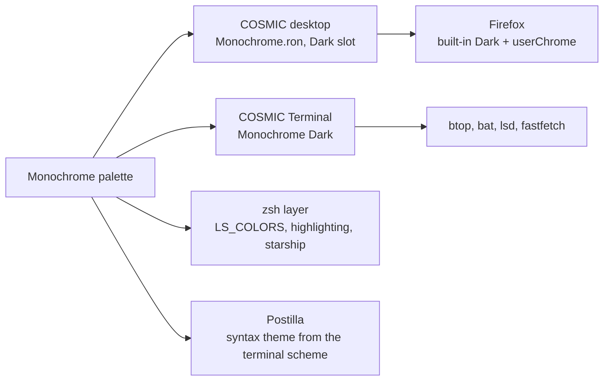

# Monochrome

> Grays only. No hue anywhere, weight and underline do the work.

Pop!_OS 24.04 on the COSMIC desktop, one palette carried through the whole
machine: desktop, terminal, shell, editor, browser. This note is the rice
describing itself, written in Markdown and rendered by **Postilla**.

## Palette

Every text colour is checked against the window background `#111111`.

| Role | Hex | Contrast on background |
|------|-----|------------------------|
| Text | `#828282` | 4.9:1 |
| Accent gray, accent | `#AAAAAA` | 8.1:1 |
| Control | `#A7A7A7` | 7.8:1 |
| Edge, borders | `#BDBDBD` | 10.1:1 |
| High, success | `#CCCCCC` | 11.8:1 |
| Higher, error | `#DDDDDD` | 13.9:1 |
| Dim | `#636363` | 3.1:1 |

Containers sit one step away from the background at `#1C1C1C`, which is
what frosted glass blurs into.

## Where the colours go



## Setup, in order

- [x] Import `cosmic/Monochrome.ron` into Appearance, **Dark** slot
- [x] Import `cosmic-term/Monochrome-term.ron`, pick **Monochrome Dark** for the profile
- [x] `./cosmic/install.sh` for fonts, **Tela-black-dark** icons and the terminal look
- [x] `./zsh/install.sh`, `./lsd/install.sh`, `./fastfetch/install.sh`
- [x] Cursor: system default
- [x] Wallpaper: `cool-wallpapers/cosmic/monochrome/monochrome-reaper-skull`
- [x] Screenshot for the README

## The baseline every rice shares

```ron
corner_radii: (
    radius_xs: (2.0, 2.0, 2.0, 2.0),   // squared corners
    radius_xl: (2.0, 2.0, 2.0, 2.0),
),
frosted: VeryLow,
frosted_windows: true,
frosted_panel: true,
frosted_applets: true,
frosted_maximized_apps: false,
gaps: (0, 7),
active_hint: 1,
```

Contrast is the WCAG ratio[^1], where $L$ is relative luminance:

```typst
$ (L_1 + 0.05) / (L_2 + 0.05) >= 4.5 $
```

---

*Rendered in Postilla, a Markdown notes app for COSMIC. The window is painted
with this rice's terminal scheme, imported as a syntax theme.*

[^1]: Web Content Accessibility Guidelines, success criterion 1.4.3. Normal text wants 4.5:1, large text 3:1.
